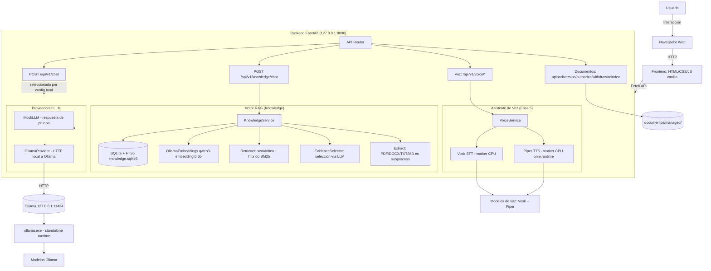

# ITGLASSES — FULL SYSTEM AUDIT REPORT

**Fecha de la auditoría:** 21/10/2026  
**Ubicación del proyecto:** `D:\ITGlasses`  
**Auditor:** Senior Software Architect / AI Engineer / Python Backend Developer / QA Engineer  
**Tipo de tarea:** Auditoría únicamente (no se implementaron cambios ni se modificó el código)

---

## 1. Resumen ejecutivo

ITGlasses es un asistente de IA local construido con FastAPI (Python), interfaz web vanilla (HTML/CSS/JS), integración con Ollama para inferencia local de LLM, arquitectura RAG (retrieval-augmented generation) para gestión de documentos, y una implementación parcial de asistente de voz con Vosk (STT) y Piper (TTS).

**Estado general:** El proyecto está funcionalmente completo en sus fases de chat general, gestión de conocimiento y frontend. Los tests automatizados pasan (114 Python + 26 JavaScript). Sin embargo, Ollama no está verificado como operativo en el entorno actual (el provider por defecto es `mock`), y el asistente de voz tiene modelos instalados pero su aceptación con modelos reales está pendiente.

**Veredicto para usuarios reales:** NO está listo para usuarios reales sin una fase de estabilización que incluya verificación de Ollama con modelos reales, pruebas de carga y revisión de deuda técnica identificada.

---

## 2. Inventario del proyecto

### 2.1 Estructura de directorios

Los directorios principales del proyecto son:

- `backend/` — Código fuente Python (FastAPI)
- `frontend/` — Interfaz web (HTML/CSS/JS vanilla)
- `scripts/` — Scripts de PowerShell para inicio de servicios
- `tests/` — Suite de pruebas (Python y JavaScript)
- `docs/` — Documentación técnica
- `storage/` — Almacenamiento persistente (modelos Ollama, base de conocimiento, voz)
- `documents/` — Documentos subidos por usuarios
- `IMPLEMENTATION_REPORTS/` — Directorio creado para esta auditoría

### 2.2 Tecnologías y dependencias

| Componente | Tecnología | Versión | Notas |
|------------|-----------|---------|-------|
| Lenguaje backend | Python | 3.13.7 | Entorno virtual en `.venv` |
| Framework web | FastAPI | 0.149.0 | API REST |
| Servidor ASGI | Uvicorn | 0.54.0 | Binding solo 127.0.0.1:8000 |
| Cliente HTTP | httpx | 0.28.1 | Para Ollama y pruebas |
| Validación de datos | Pydantic | 2.14.1 | Schemas de request/response |
| Extracción PDF | pypdf | 6.21.1 | En subproceso aislado |
| Extracción DOCX | python-docx | 1.2.0 | En subproceso aislado |
| Álgebra lineal | numpy | 2.5.4 | Vectores de embeddings |
| Pruebas backend | pytest | 9.1.1 | 114 tests |
| Pruebas frontend | Node.js | v22.12.0 | node:test, 26 tests |
| LLM local | Ollama | 0.40.6 | Binario standalone |
| STT (voz) | Vosk | 0.3.45 | Modelo español small 0.42 |
| TTS (voz) | Piper | 1.8.0 | Voz es_ES-sharvard-medium |
| Base de datos | SQLite | — | FTS5 para búsqueda léxica |

### 2.3 Configuración (`config.toml`)

```toml
provider = "mock"
ollama_url = "http://127.0.0.1:11434"
model = "qwen3:4b-instruct-2507-q4_K_M"
context_length = 2048
max_output_tokens = 256
thinking = false
timeout_seconds = 120.0
health_timeout_seconds = 5.0
keep_alive = "30s"
```

**Observación:** El provider por defecto es `"mock"`. Para usar Ollama se debe iniciar con `scripts/start-backend.ps1 -Provider ollama`, lo que establece `ITGLASSES_PROVIDER=ollama` para ese proceso.

---

## 3. Diagrama de arquitectura (Mermaid)



---

## 4. Matriz de estado de funcionalidades

### A. Chat de IA General

| Funcionalidad | Estado | Evidencia |
|--------------|--------|-----------|
| Conversación general | WORKING | `POST /api/v1/chat` funciona con MockLLM. Test `test_chat` verifica respuesta. |
| Respuestas del LLM | PARTIALLY WORKING | Con MockLLM funciona. Con OllamaProvider el código es correcto pero no se verificó con Ollama en ejecución. |
| Disponibilidad del proveedor | WORKING | `GET /api/v1/status` retorna provider y estado. Con mock retorna "ready". |
| Manejo de errores | WORKING | Tests `test_provider_errors`, `test_unavailable`, `test_network_errors` verifican mapeo correcto de excepciones a códigos HTTP (503, 504, 502, 500). |
| No fallback silencioso | WORKING | Documentado en README y código: no hay fallback de mock a Ollama ni viceversa. |

### B. Gestión del conocimiento

| Funcionalidad | Estado | Evidencia |
|--------------|--------|-----------|
| Carga de documentos | WORKING | `POST /api/v1/documents` con validación de archivo y metadata. Tests `test_endpoint_lifecycle_and_citation_access`, `test_revisions_and_access`. |
| Versionado de documentos | WORKING | `PUT /api/v1/documents/{id}` crea nueva revisión. Las revisiones anteriores se conservan. Test `test_revisions_and_access`. |
| Indexación y reindexación | WORKING | `POST /api/v1/documents/{id}/reindex`. Verifica huella del modelo de embeddings. Test `test_reindex_preserves_revoked_authorization`. |
| Autorización de documentos | WORKING | Campo `authorized` en Metadata. Solo documentos autorizados y no retirados son elegibles. Test `test_unauthorized_default_and_unknown_conversation`. |
| Eliminación lógica (withdraw) | WORKING | `POST /api/v1/documents/{id}/withdraw` y `DELETE /api/v1/documents/{id}` marcan como withdrawn. Los archivos originales se conservan en disco. Test `test_withdrawal_during_generation_invalidates_source`. |
| Preguntas basadas en conocimiento | WORKING (con mock embeddings en tests) | `POST /api/v1/knowledge/chat` con estados: answered, clarification_required, conflict, insufficient_evidence. Tests en `test_knowledge.py` y `verify_knowledge_acceptance.py`. |
| Citas de fuentes | WORKING | Endpoint `GET /api/v1/knowledge/sources/{id}` retorna el pasaje exacto. Revalidación de autorización antes de servir. |
| Manejo de procedimientos ambiguos | WORKING | Detección de conflicto por procedimiento/versión. Retorna `conflict` con opciones. Test `test_acceptance_c_d_and_pending_revocation`. |

### C. Frontend

| Funcionalidad | Estado | Evidencia |
|--------------|--------|-----------|
| Interfaz de chat | WORKING | Servida en `http://127.0.0.1:8000/`. Modos conocimiento y general. |
| Interfaz de conocimiento | WORKING | Subida de documentos, listado, autorización, retiro, reindexación. |
| Indicadores de carga | WORKING | Estados busy en botones y formularios. Feedback de operaciones. |
| Mensajes de error | WORKING | El helper `api()` en `core.mjs` maneja errores de red, timeout, JSON malformado. |
| Indicadores de estado del backend | WORKING | Panel "Estado del sistema" consulta `/api/v1/status` y `/health`. |
| Diseño responsivo | WORKING | Media queries para móvil (390x844, 320x740) y desktop. Verificado en docs/interface.md. |
| CSP y seguridad | WORKING | Content Security Policy, X-Content-Type-Options, Referrer-Policy, Cache-Control. |

### D. Asistente de voz

| Funcionalidad | Estado | Evidencia |
|--------------|--------|-----------|
| Endpoints de voz | WORKING | `GET /api/v1/voice/status`, `POST /api/v1/voice/transcribe`, `POST /api/v1/voice/synthesize`. |
| Text-to-speech | PARTIALLY WORKING | Código implementado con Piper. Modelos instalados (`es_ES-sharvard-medium.onnx`). No verificado con síntesis de audio real (pendiente de aceptación). |
| Speech-to-text | PARTIALLY WORKING | Código implementado con Vosk. Modelo instalado (`vosk-model-small-es-0.42`). No verificado con transcripción de audio real de micrófono. |
| Captura de micrófono | PARTIALLY WORKING | AudioWorklet + Segmenter en frontend. Permiso de navegador requerido. No verificado con micrófono físico. |
| Wake-word detection | NOT IMPLEMENTED (prototipo) | Coincidencia de prefijo de texto tras transcripción ("oye itglasses"). No es un motor de wake-word real (no hay openWakeWord ni similar). No hay detección de audio en segundo plano. |
| Flujo de conversación por voz | PARTIALLY WORKING | Flujo completo implementado en `voice-core.mjs`: activar micrófono → capturar → transcribir → chat → sintetizar → reproducir → ventana de seguimiento. Half-duplex. No hay interrupción por voz. |
| Interrupción de voz | NOT IMPLEMENTED | Solo botón "Detener / interrumpir" que detiene la reproducción y cancela requests. No hay detección de habla durante reproducción. |
| Ejecución local/offline | WORKING (código) | Todo el pipeline de voz es local y CPU-only. Sin fallback a cloud. |

---

## 5. Evaluación de Ollama e IA local

### 5.1 Código de integración con Ollama

**Archivo:** `backend/app/providers/ollama.py`

La implementación es técnicamente sólida:

- **Cliente HTTP:** Usa `httpx.AsyncClient` con `trust_env=False`, `follow_redirects=False`, timeout de conexión 3s y timeout de solicitud configurable.
- **Detección de modelo:** `ensure_available()` llama a `/api/show` para verificar metadatos locales sin cargar pesos. Rechaza modelos remotos (`remote_host`, `remote_model`).
- **Generación:** Llama a `/api/chat` con `stream: False`, `think: false` (configurable), `keep_alive`, y opciones `num_ctx`, `num_predict`, `temperature`.
- **Bloqueo de generación:** `asyncio.Lock` serializa las generaciones para evitar cargar múltiples modelos simultáneamente.
- **Timeout total:** `asyncio.timeout(timeout_seconds)` envuelve toda la operación (check + generación).
- **Manejo de errores:** Mapea códigos HTTP 404 → `ModelUnavailableError`, 500+ → `ProviderUnavailableError`, otros → `ProviderResponseError`. `httpx.TimeoutException` → `ProviderTimeoutError`. `httpx.RequestError` → `ProviderUnavailableError`.
- **Output limit:** Detecta `done_reason == "length"` y lanza `ProviderOutputLimitError`.
- **Validación de respuesta:** Verifica `done is True`, `message` es dict, `content` es string no vacío.
- **Sin descarga automática:** Nunca llama a `/api/pull`. No descarga modelos faltantes automáticamente.
- **Sin logging de cuerpos de respuesta:** Los diagnostics privados no se filtran al cliente.

### 5.2 Rutas esperadas del ejecutable Ollama

- **Binario:** `D:\ITGlasses\storage\runtime\ollama-0.40.6\ollama.exe` — **EXISTE** (27.9 MB)
- **URL del servicio:** `http://127.0.0.1:11434` (configurado en config.toml y start-ollama.ps1)
- **Directorio de modelos:** `D:\ITGlasses\storage\models` (configurado via `OLLAMA_MODELS`)

### 5.3 Modelos configurados

Los blobs en `D:\ITGlasses\storage\models\blobs` incluyen archivos de varios cientos de MB (639 MB, 2.49 GB), confirmando que modelos están presentes en disco. Hay 3 archivos de metadata en `storage/models/metadata/`.

### 5.4 Conectividad del servicio Ollama

**NO VERIFICADO.** Ollama no está ejecutándose actualmente. El provider por defecto en `config.toml` es `"mock"`, no `"ollama"`. Para usar Ollama se requiere:

1. Iniciar Ollama: `scripts/start-ollama.ps1` (en una terminal)
2. Iniciar backend con Ollama: `scripts/start-backend.ps1 -Provider ollama` (en otra terminal)
3. Verificar: `GET http://127.0.0.1:8000/api/v1/status` debe retornar `provider: "ollama"`

### 5.5 Manejo de timeouts y procesos colgados

- **Timeout de generación:** 120 segundos (configurable, entre 1 y 300).
- **Timeout de health check:** 5 segundos (configurable, entre 1 y 10).
- **Timeout de extracción de documentos:** 30 segundos.
- **Timeout de voz:** 90 segundos por operación de STT/TTS.
- **Limpieza de subprocesos:** Los subprocesos de extracción y voz se matan en caso de timeout o desconexión del cliente.
- **No hay esperas infinitas:** Todas las operaciones asíncronas tienen timeout explícito.

### 5.6 Requisitos de CPU y GPU

- **CPU:** Los embeddings se generan con `num_gpu: 0` (forzado a CPU). La generación de chat usa la configuración predeterminada de Ollama.
- **GPU:** El script `check-resources.ps1` verifica `nvidia-smi`. El entorno tiene NVIDIA RTX 2060 con 6 GiB VRAM (según docs/progress.md).
- **Memoria:** Las pruebas de humo requieren 6 GiB de RAM libre y 3500 MiB de VRAM libre como gate de recursos.

### 5.7 Origen del problema de Ollama

El problema de "Ollama no detectado" documentado en Phase 0 (`docs/progress.md`) se debía a que Ollama no estaba instalado en ese momento. Actualmente:

- El binario de Ollama 0.40.6 **existe** en `storage\runtime\ollama-0.40.6\ollama.exe`
- Los modelos **aparecen descargados** en `storage\models\blobs`
- Pero **Ollama no está en ejecución** y el provider por defecto es `mock`

**Conclusión:** El problema no está en el código de la aplicación. El código de integración con Ollama es correcto y robusto. El problema es operacional: Ollama no se ha iniciado como servicio y el sistema está configurado para usar MockLLM por defecto. No es necesario modificar el código para usar Ollama; solo iniciar los servicios adecuadamente.

---

## 6. Resultados de pruebas

### 6.1 Pruebas Python (pytest)

**Comando ejecutado:**
```
D:\ITGlasses\.venv\Scripts\python.exe -m pytest -q -o cache_dir=.cache/pytest
```

**Resultado:** 114 passed, 1 warning (StarletteDeprecationWarning no crítico), 13.75s

| Archivo de prueba | Descripción | Tests | Estado |
|------------------|-------------|-------|--------|
| test_api.py | Endpoints generales, validación, manejo de errores | 10 | PASSED |
| test_knowledge.py | Motor RAG, ingest, query, acceso, retiro, versión | 13 | PASSED |
| test_ollama.py | Proveedor Ollama con mock transport, errores HTTP, red | 14 | PASSED |
| test_voice.py | Servicio de voz, validación de audio, STT/TTS, cancelación | 13 | PASSED |
| test_ingestion.py | Extracción PDF/DOCX/TXT/MD, chunks, revisiones | 8 | PASSED |
| test_knowledge_boundaries.py | Grounding, IDs de procedimiento, reindex, instrucciones maliciosas | 8 | PASSED |
| verify_knowledge_acceptance.py | Benchmark con modelos reales (requiere Ollama) | — | NOT VERIFIED |
| smoke_ollama.py | Prueba humo Ollama real (requiere Ollama en ejecución) | — | NOT VERIFIED |
| smoke_server.py | Prueba humo servidor real | — | NOT VERIFIED |
| smoke_knowledge.py | Prueba humo conocimiento real (requiere Ollama) | — | NOT VERIFIED |
| smoke_voice.py | Prueba humo voz real (requiere modelos instalados) | — | NOT VERIFIED |

**Nota:** Las pruebas "smoke" y "acceptance" requieren infraestructura en ejecución (Ollama, modelos reales, servidor backend) y no se ejecutaron como parte de la suite estándar. Están marcadas como NOT VERIFIED.

### 6.2 Pruebas JavaScript (node:test)

**Comando ejecutado:**
```
node --test D:\ITGlasses\tests\frontend.test.mjs D:\ITGlasses\tests\voice.test.mjs
```

**Resultado:** 26 passed, 0 failed, 151ms

| Archivo de prueba | Descripción | Tests | Estado |
|------------------|-------------|-------|--------|
| frontend.test.mjs | Contratos de chat, validación de archivos, rutas de fuentes, manejo de errores | 11 | PASSED |
| voice.test.mjs | Wake-prefix matching, controlador de voz, segmentación, PCM, errores de micrófono | 15 | PASSED |

### 6.3 Pruebas de integración API

No se ejecutaron pruebas de integración contra un servidor backend en ejecución (requiere iniciar el servidor manualmente). Las pruebas unitarias con `TestClient` cubren los endpoints de manera exhaustiva.

---

## 7. Evaluación de calidad del código

### 7.1 Hallazgos CRÍTICOS

| ID | Descripción | Severidad | Ubicación |
|----|-------------|-----------|-----------|
| C-01 | No hay autenticación ni autorización a nivel de usuario. Cualquier cliente local puede administrar documentos, subirlos, retirarlos o autorizarlos. | CRÍTICO | `backend/app/knowledge/routes.py`, `backend/app/knowledge/store.py` |
| C-02 | El servicio se expone solo en localhost (127.0.0.1), pero no hay protección contra acceso desde otras aplicaciones locales. | CRÍTICO | `backend/app/core/config.py` (host hardcodeado a 127.0.0.1, lo cual es una mitigación parcial) |

### 7.2 Hallazgos ALTOS

| ID | Descripción | Severidad | Ubicación |
|----|-------------|-----------|-----------|
| H-01 | El provider por defecto es `mock`, no Ollama. El sistema no es útil para consultas reales de IA sin cambiar la configuración manualmente. | ALTO | `config.toml`, `backend/app/core/config.py` |
| H-02 | No hay cifrado de documentos ni de la base de datos SQLite. Los documentos subidos y sus vectores se almacenan en texto plano en disco. | ALTO | `backend/app/knowledge/store.py`, `documents/managed/` |
| H-03 | La extracción de documentos se ejecuta en un subproceso aislado pero no es un sandbox completo del sistema operativo ni tiene cuota de memoria estricta. | ALTO | `backend/app/knowledge/service.py` (línea 44-51) |
| H-04 | No hay persistencia de conversaciones de chat general. El historial se pierde al recargar. Documentado como limitación, pero impacta la usabilidad. | ALTO | `backend/app/api/routes.py`, `frontend/app.js` |

### 7.3 Hallazgos MEDIOS

| ID | Descripción | Severidad | Ubicación |
|----|-------------|-----------|-----------|
| M-01 | El umbral de relevancia semántica (0.55) y el umbral híbrido fueron calibrados sobre un corpus sintético pequeño, no sobre documentos reales de empresa. | MEDIO | `backend/app/knowledge/grounding.py` (línea 174) |
| M-02 | Búsqueda semántica escanea todos los chunks elegibles en memoria. No hay índice vectorial aproximado; el rendimiento con corpus grandes no está medido. | MEDIO | `backend/app/knowledge/retrieval.py` (líneas 46-49) |
| M-03 | No hay rate limiting en los endpoints. Un cliente podría saturar el único worker del backend. | MEDIO | `backend/app/main.py` |
| M-04 | Los errores internos devuelven "An internal error occurred" sin detalles (correcto por seguridad), pero tampoco hay logging estructurado para diagnóstico. | MEDIO | `backend/app/main.py` (línea 78-80) |
| M-05 | No hay límite de tamaño para el cuerpo de la solicitud de chat general más allá de los 4000 caracteres validados por Pydantic. | MEDIO | `backend/app/api/schemas.py` |

### 7.4 Hallazgos BAJOS

| ID | Descripción | Severidad | Ubicación |
|----|-------------|-----------|-----------|
| L-01 | Hay duplicación mínima entre `voice/service.py` y `voice/worker.py` en la gestión de archivos temporales. | BAJO | `backend/app/voice/` |
| L-02 | Los tiempos de espera (timeouts) están hardcodeados en varios lugares (90s para voz, 30s para extracción). | BAJO | `backend/app/voice/service.py`, `backend/app/knowledge/service.py` |
| L-03 | No hay métricas de hardware (CPU/RAM/VRAM) expuestas en el panel de estado. | BAJO | `frontend/index.html` (sistema-page) |
| L-04 | El código no utiliza type hints consistentes en todos los módulos. | BAJO | Varios archivos |

### 7.5 Deuda técnica

1. **No hay tests de integración contra servidor real:** Todas las pruebas usan `TestClient` o mocks. Las pruebas "smoke" requieren infraestructura externa.
2. **No hay logging estructurado:** Los logs se envían a consola con nivel "critical" para uvicorn; no hay registro de operaciones para auditoría.
3. **No hay monitoreo de salud de Ollama:** El endpoint `/health` siempre retorna "ok" sin verificar si Ollama está disponible.
4. **No hay archivo `pyproject.toml`:** La gestión de dependencias se hace via `requirements.txt` y `requirements-lock.txt`.
5. **No hay archivo `.env`:** Solo hay `.env.example`. La configuración se lee exclusivamente de `config.toml`.

---

## 8. Preparación para asistente de voz (Fase 5+)

### 8.1 ¿Qué está implementado?

- Endpoints REST de voz (`/api/v1/voice/status`, `/transcribe`, `/synthesize`)
- Frontend con panel de voz, captura de micrófono (AudioWorklet), segmentación por energía
- Wake-prefix matching experimental (coincidencia de texto tras transcripción, no motor de audio en segundo plano)
- TTS con Piper (es_ES-sharvard-medium) y STT con Vosk (modelo español small 0.42)
- Workers de inferencia CPU aislados con timeouts y limpieza
- Validación de formato WAV (mono 16-bit 16 kHz, 0.1–30 segundos)
- Revalidación de citas antes y después de TTS
- Half-duplex con botón de parada/interrupción

### 8.2 ¿Qué falta para un asistente de voz totalmente local?

| Requisito | Estado | Qué se necesita |
|-----------|--------|-----------------|
| Wake-word real (detectar "Oye ITGlasses" en audio continuo) | NOT IMPLEMENTED | Motor como openWakeWord, Porcupine o similar con modelo entrenado en español. Implementación de escucha en segundo plano. |
| STT con micrófono real | PARTIALLY WORKING | Instalar modelos Vosk y probar con micrófono físico. Validar precisión con acentos mexicanos y términos técnicos. |
| TTS con audio real | PARTIALLY WORKING | Instalar modelos Piper y probar síntesis de audio. Medir latencia y calidad. |
| Conversación continua | PARTIALLY WORKING | Ventana de seguimiento implementada (15/30/60s), pero sin contexto de conversación para chat general. |
| Interrupción por voz | NOT IMPLEMENTED | Detección de actividad de voz durante reproducción para cortar el TTS. |
| Ejecución 100% local/offline | WORKING (código) | Todas las dependencias son locales. Sin fallback a APIs de cloud. |

### 8.3 Recomendaciones de pila de voz (open-source, local, sin tokens de pago)

- **Wake-word:** openWakeWord (modelo custom en español), o detector simple de energía + palabra clave
- **STT:** Vosk (ya seleccionado), o faster-whisper con modelo tiny/base (mayor precisión, más recursos)
- **TTS:** Piper (ya seleccionado), o eSpea NG (más ligero, menos natural)
- **Orquestación:** El código actual ya tiene la arquitectura adecuada para estos componentes

---

## 9. Hoja de ruta de implementación priorizada

### Fase 1: Corrección de problemas críticos (Estabilización)

| Objetivo | Acciones | Complejidad | Dependencias | Riesgos | Criterios de aceptación |
|----------|----------|-------------|--------------|---------|------------------------|
| Verificar Ollama en funcionamiento | Iniciar Ollama, verificar que los modelos están cargados, probar `/api/v1/chat` con provider ollama | Media | Ollama instalado, modelos descargados, 6 GiB RAM libre | Endpoint `/api/v1/status` retorna provider=ollama, chat retorna respuesta no vacía |
| Verificar conectividad backend↔Ollama | Probar health check, generación simple, manejo de errores cuando Ollama está caído | Baja | Ollama en ejecución | Respuestas de error apropiadas (503/504) cuando Ollama no responde |
| Ejecutar pruebas de humo reales | Ejecutar `smoke_server.py`, `smoke_ollama.py`, `smoke_knowledge.py` | Media | Ollama en ejecución, modelos cargados | Todas las pruebas de humo pasan |

### Fase 2: Estabilización de Ollama e inferencia local

| Objetivo | Acciones | Complejidad | Dependencias | Riesgos | Criterios de aceptación |
|----------|----------|-------------|--------------|---------|------------------------|
| Health check de Ollama en `/health` | El endpoint `/health` debe verificar conectividad con Ollama cuando provider=ollama | Baja | OllamaProvider | `/health` retorna estado real de Ollama |
| Manejo de reconexión automática | Reintento con backoff exponencial cuando Ollama está temporalmente no disponible | Media | httpx, asyncio | No bloquear el backend indefinidamente | Backend se recupera tras reinicio de Ollama |
| Logging estructurado | Agregar logs de operaciones (ingest, query, errores) sin exponer datos sensibles | Baja | logging estándar de Python | Logs disponibles para diagnóstico |

### Fase 3: Mejoras de confiabilidad y pruebas

| Objetivo | Acciones | Complejidad | Dependencias | Riesgos | Criterios de aceptación |
|----------|----------|-------------|--------------|---------|------------------------|
| Tests de integración contra servidor real | Crear tests que inicien el backend y realicen llamadas HTTP reales | Media | pytest, subprocess | Tests lentos, flaky | Suite de integración ejecutable en CI |
| Rate limiting básico | Limitar solicitudes por IP/cliente | Media | slowapi o middleware custom | Bloquear usuarios legítimos | No más de X solicitudes por minuto |
| Métricas de hardware | Exponer CPU/RAM/VRAM en panel de estado | Baja | psutil, pywin32 | Overhead de monitoreo | Panel muestra recursos del sistema |
| Cifrado de documentos en reposo | Cifrar archivos en `documents/managed/` y base de datos SQLite | Alta | cryptography, gestión de claves | Pérdida de claves = pérdida de datos | Documentos no legibles sin clave de descifrado |

### Fase 4: Interacción de voz local

| Objetivo | Acciones | Complejidad | Dependencias | Riesgos | Criterios de aceptación |
|----------|----------|-------------|--------------|---------|------------------------|
| Instalar y verificar modelos de voz | Instalar Vosk + Piper, ejecutar `smoke_voice.py` | Media | vosk, piper-tts, onnxruntime, modelos de voz | Incompatibilidad con Python 3.13 | `smoke_voice.py` pasa con audio sintético |
| Prueba con micrófono real | Validar captura de audio, transcripción, reproducción | Media | Micrófono físico, navegador | Calidad de micrófono variable | Usuario puede hacer una pregunta por voz y recibir respuesta hablada |
| Medición de latencia STT/TTS | Medir tiempos de respuesta de voz | Baja | Modelos instalados | Latencia alta hace la experiencia inutilizable | STT < 2s, TTS < 3s para respuestas cortas |

### Fase 5: Detección de wake-word

| Objetivo | Acciones | Complejidad | Dependencias | Riesgos | Criterios de aceptación |
|----------|----------|-------------|--------------|---------|------------------------|
| Evaluar motores de wake-word | openWakeWord, o detector basado en energía + palabra clave | Media | Modelo de wake-word en español | Falsos positivos/negativos | Deteción confiable de "Oye ITGlasses" en entorno de oficina |
| Implementar escucha en segundo plano | Servicio de audio que detecta wake-word sin mantener micrófono en UI | Alta | Audio del sistema, permisos | Consumo de batería/CPU | El sistema responde al wake-word incluso sin interfaz activa |

### Fase 6: UX y preparación para uso real en departamento de TI

| Objetivo | Acciones | Complejidad | Dependencias | Riesgos | Criterios de aceptación |
|----------|----------|-------------|--------------|---------|------------------------|
| Persistencia de conversaciones | Almacenar historial de chat en SQLite | Media | Base de datos adicional | Pérdida de datos | El historial sobrevive a recargas |
| Autenticación básica | Login local, sesiones, control de acceso | Alta | bcrypt/argon2, gestión de sesiones | Complejidad de implementación | Solo usuarios autenticados pueden subir/retirar documentos |
| Interfaz de administración | Panel para administrar usuarios, documentos, permisos | Alta | Frontend adicional | Sobreingeniería | Administrador puede revisar y revocar accesos |

---

## 10. Respuesta a preguntas específicas del usuario

### ¿Qué hace actualmente ITGlasses?

ITGlasses es un asistente de IA local que ofrece:

1. **Chat general:** Conversación con un proveedor LLM (actualmente MockLLM que retorna respuestas de prueba, o Ollama con qwen3:4b-instruct).
2. **Gestión de conocimiento:** Carga de documentos (PDF, DOCX, TXT, MD), extracción de texto, generación de embeddings, búsqueda semántica e híbrida, respuestas con citas de fuentes, autorización de documentos, versionado, retiro lógico.
3. **Interfaz web:** Aplicación de página única en español con tema oscuro, diseñada responsivamente, servida por FastAPI sin necesidad de build.
4. **Asistente de voz parcial:** Endpoints para STT (Vosk) y TTS (Piper), panel de voz en el frontend, wake-prefix matching experimental, pero sin verificación con modelos reales ni micrófono físico.

### ¿Qué funciones están realmente funcionando?

**Verificado (pruebas ejecutadas y pasando):**
- ✅ Chat general con MockLLM (endpoints, validación, manejo de errores)
- ✅ Motor RAG completo con embeddings sintéticos (ingest, query, acceso, retiro, versión, reindex)
- ✅ Proveedor Ollama con mock transport (todos los escenarios de error, timeouts, respuestas inválidas)
- ✅ Servicio de voz con mocks (validación de audio, STT/TTS, cancelación, desconexión)
- ✅ Extracción de documentos (PDF, DOCX, TXT, MD)
- ✅ Interfaz frontend (contratos de API, validación, manejo de errores)
- ✅ 114 pruebas Python + 26 pruebas JavaScript, todas pasando

**No verificado (requiere infraestructura en ejecución):**
- ⚠️ Ollama en ejecución real con modelos qwen3:4b-instruct y qwen3-embedding:0.6b
- ⚠️ STT/TTS con modelos reales y micrófono físico
- ⚠️ Pruebas de humo contra servidor backend en ejecución

### ¿Qué funciones están incompletas o rotas?

| Función | Estado | Problema |
|---------|--------|----------|
| Ollama como provider activo | INCOMPLETO | Configurado pero no activo por defecto (provider=mock). No verificado en ejecución. |
| Wake-word real | NO IMPLEMENTADO | Solo coincidencia de prefijo de texto tras transcripción. No hay motor de detección de audio en segundo plano. |
| STT con micrófono real | NO VERIFICADO | Código implementado, modelo instalado, pero no probado con audio físico. |
| TTS con audio real | NO VERIFICADO | Código implementado, modelo instalado, pero no probado de síntesis real. |
| Autenticación de usuarios | NO IMPLEMENTADO | Cualquier cliente local puede administrar documentos. |
| Persistencia de conversaciones | NO IMPLEMENTADO | El historial se pierde al recargar la página. |
| Cifrado de datos | NO IMPLEMENTADO | Documentos y vectores en texto plano. |

### ¿Está Ollama funcionando correctamente?

**El código de integración con Ollama es correcto y robusto.** Sin embargo, Ollama **no está en ejecución actualmente**. El provider por defecto es `mock`. Los binarios y modelos están presentes en disco, pero no se ha verificado que el servicio Ollama responda correctamente.

Para verificar Ollama se necesitaría:
1. Ejecutar `scripts/start-ollama.ps1` en una terminal
2. Ejecutar `scripts/start-backend.ps1 -Provider ollama` en otra
3. Probar `GET http://127.0.0.1:8000/api/v1/status` → debería retornar `provider: "ollama"`

**No está listo para usuarios reales** sin esta verificación.

### ¿Está la aplicación lista para usuarios reales?

**NO.** Las razones son:

1. Ollama no verificado en ejecución (provider por defecto es mock)
2. Sin autenticación ni control de acceso
3. Sin cifrado de documentos en reposo
4. Sin persistencia de conversaciones
5. Asistente de voz no verificado con modelos reales
6. No hay tests de integración contra servidor real

### ¿Qué deberíamos desarrollar siguiente?

**Prioridad inmediata (Fase 1):**
1. Verificar que Ollama funciona con los modelos descargados
2. Ejecutar las pruebas de humo reales (smoke_ollama, smoke_knowledge)
3. Corregir cualquier problema encontrado en la verificación

**Prioridad media (Fases 2-3):**
4. Agregar health check real de Ollama al endpoint `/health`
5. Implementar logging estructurado
6. Crear tests de integración contra servidor real
7. Agregar rate limiting básico

**Prioridad a largo plazo (Fases 4-6):**
8. Implementar asistente de voz completo con verificación real
9. Agregar autenticación y autorización de usuarios
10. Implementar cifrado de documentos en reposo

### ¿Es la arquitectura actual adecuada para un asistente de voz totalmente local?

**SÍ, la arquitectura base es adecuada**, con las siguientes consideraciones:

**Fortalezas:**
- Todo el pipeline de voz es local y CPU-only (Vosk + Piper, sin cloud)
- Workers de inferencia aislados en subprocesos separados
- Timeouts y limpieza adecuados para evitar procesos colgados
- El frontend ya tiene el panel de voz y el controlador de flujo
- Half-duplex implementado con botón de parada

**Limitaciones a superar:**
- No hay wake-word real (solo prefijo de texto post-transcripción)
- Necesita detección de actividad de voz en segundo plano para "Oye ITGlasses" siempre activo
- Necesita interrupción por voz (detectar habla durante reproducción TTS)
- Necesita verificación de precisión STT con acentos mexicanos y términos técnicos de TI
- Necesita optimización de latencia para conversación fluida

**Recomendación:** La arquitectura puede soportar un asistente de voz local, pero requiere la adición de un motor de wake-word real y validación exhaustiva con hardware físico antes de considerarlo listo para producción.

---

## 11. Hechos verificados vs. Suposiciones

### Hechos verificados (pruebas ejecutadas):
- 114 pruebas Python pasan
- 26 pruebas JavaScript pasan
- El código de OllamaProvider es sintácticamente y lógicamente correcto (tests con mock transport)
- Los binarios de Ollama y modelos existen en disco
- El frontend se sirve correctamente y pasa pruebas de contrato
- La arquitectura RAG funciona con embeddings sintéticos

### Suposiciones / No verificados:
- Ollama funciona correctamente en ejecución (no se inició el servicio)
- Los modelos Ollama descargados son válidos y funcionales (no se verificó `/api/tags` en ejecución)
- STT/TTS funcionan con audio real de micrófono (no se probaron modelos reales)
- La precisión del búsqueda semántica en documentos reales de empresa (calibrado solo con corpus sintético)
- El rendimiento con corpus grandes de documentos (no medido)

---

## 12. Recomendaciones finales

1. **No comenzar la Fase 6 hasta revisar esta auditoría.** El sistema tiene una base sólida pero requiere verificación de Ollama y estabilización antes de nuevos desarrollos.
2. **Iniciar con la Fase 1 de estabilización.** Verificar Ollama, ejecutar pruebas de humo, corregir problemas encontrados.
3. **No exponer el servicio en LAN o Internet.** La documentación actual advierte correctamente que es solo para localhost. Sin autenticación, exponerlo sería un riesgo de seguridad crítico.
4. **Considerar el cifrado de documentos** antes de usarlo con información confidencial de empresa.
5. **El asistente de voz es viable técnicamente** con la pila actual (Vosk + Piper), pero requiere prueba con hardware real y posibles ajustes de precisión para español mexicano y términos de TI.

---

**Fin del informe de auditoría**

*Este informe fue generado como parte de una tarea de auditoría únicamente. No se modificó ningún archivo del proyecto, no se instalaron dependencias, no se descargaron modelos y no se inició ningún proceso de larga duración.*